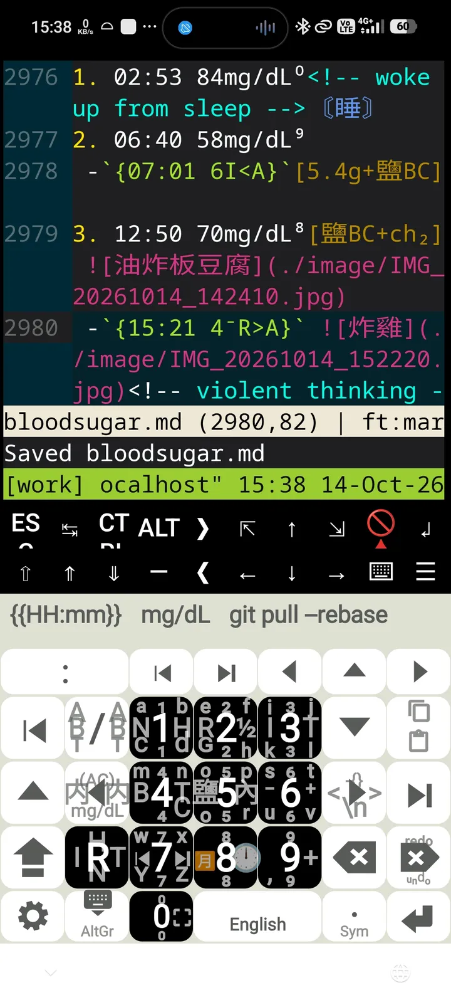
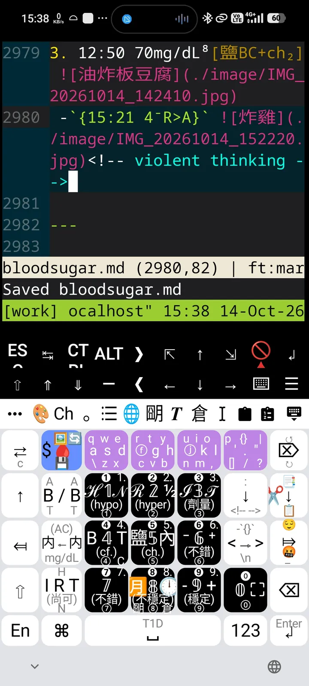
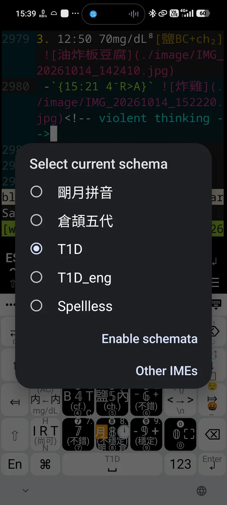
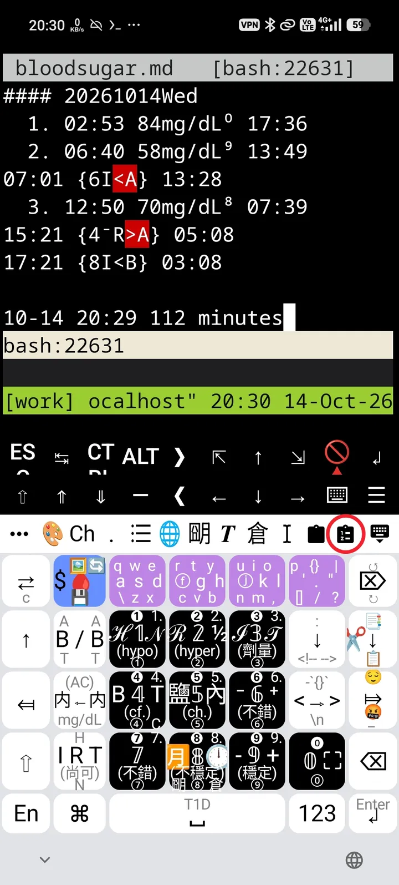

# Trime's T1D keyboard

<table>
  <tr>
    <td align="center" width="33%">
       
      <b>T1D keyboard in MOK</b>
    </td>
    <td align="center" width="33%">
       
      <b>T1D keyboard in Trime</b>
    </td>
    <td align="center" width="33%">
       
      <b>Trime's Schema list</b>
    </td>
  </tr>
</table>

## Source:

- https://github.com/osfans/trime
- https://github.com/rime/home
- https://github.com/EricWay1024/spellless-fcitx5

## Why I design a keyboard in Trime for my bloodsugar log:

I have used Multiling O Keyboard in Android for quite a time. It provides an awesome framework for personal keyboard design and setting, thus a great tool for my bloodsugar logging. For this period, I have added and modified shortcuts, key-combinations and various icons by my needs, and I have had really a good time by using this incredible android app in my health improving.

However, some issues happen when my old android phone is replaced by a new android 16 system: MOK's bottom bar would be overlapped by OS's gesture insets, and its Chinese inputs make it freezed and reset because of priority fighting. Moreover, it is a sad thing that MOK has not been updated by Honso since Jan 31, 2025 in google's playstore, and I have no idea how to fix these issues without its opensource.

Luckily, here is opensourced Trime in which I am quite familiar with its core Rime, for that I have used ibus then fcitx for years. As a result, this tongwen-T1D keyboard in Trime is created.

By my original MOK's keyboard arrangment, this tongwen-T1D keyboard has more features due to its usage on tmux, micro and cli-agents (Opencode and ClaudeCode) in Termux. There are still many issues, and I will do as much as I can to improve this keyboard setting with my bloodsugar logging.

## Keyboard Notation Decipherment

Please visit [https://github.com/louisophie/BG_record/](https://github.com/louisophie/BG_record/) for clarification.

## Functions added
- **Personal-clipboard** (mimics MOK): long-pressing the icon would pop up entries in "./rime/personal-clipboard.md", then sliding upon it for pasting.

  

- **Corner swipes** (mimics MOK): adding 4 corner-sliding for "swipe_right_up", "swipe_right_down", "swipe_left_up" and "swipe_left_down". With Trime's owned "click", "swipe_up", "swipe_down", "swipe_left", "swipe_right" and "long_click", there are 10 ways of key-in for a single button.
- **Current Date and Time inserting.**
- **One-tap switching** for IME and Trime's schema changing.

## Files for keyboard
- ./rime/tongwen-T1D.trime.yaml
- ./rime/tongwen-T1D.trime.custom.yaml

## Usage
- After cloning, rebuilding and apk installing (or do "trime-debug-20261014.apk" installation), redirect "User directory" to the folder "rime" in Profile option of Trime's setting page.